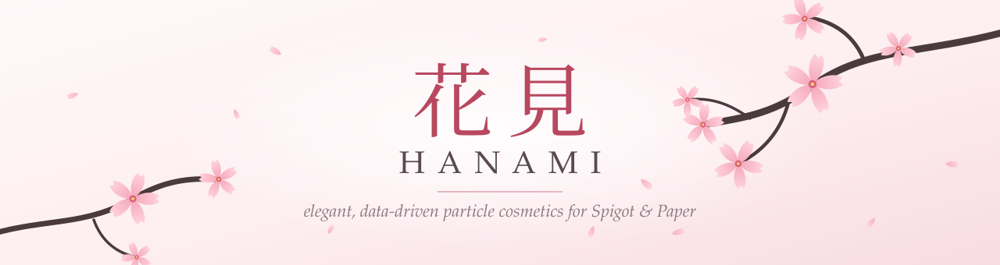
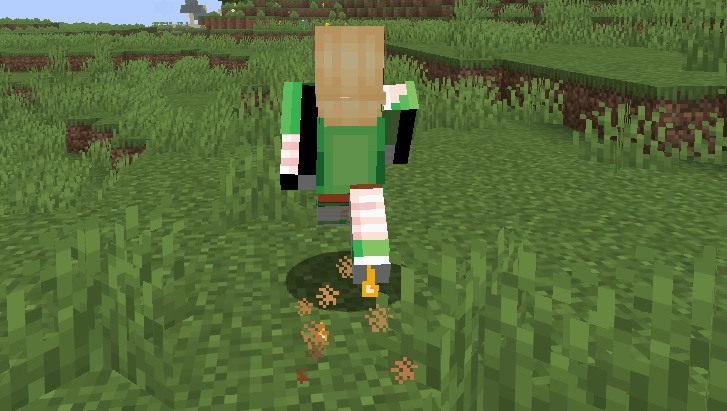
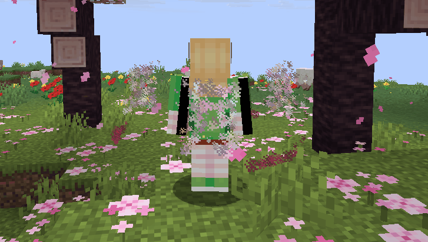
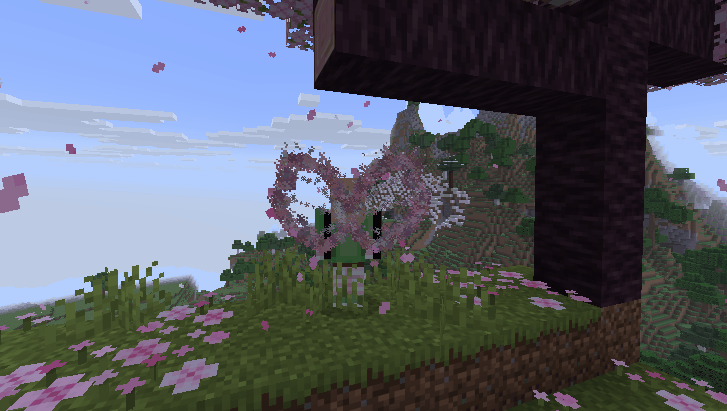
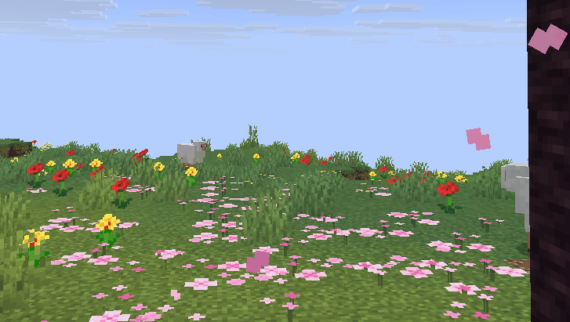
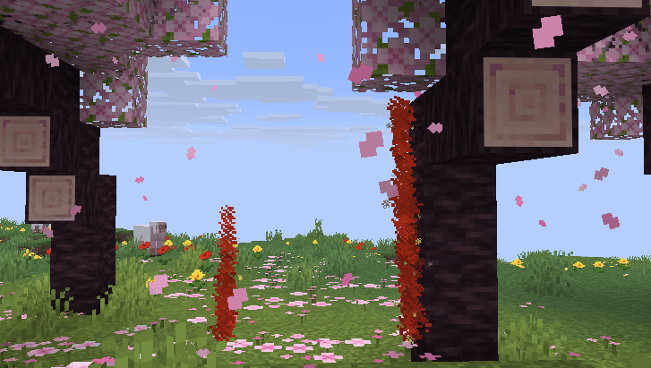
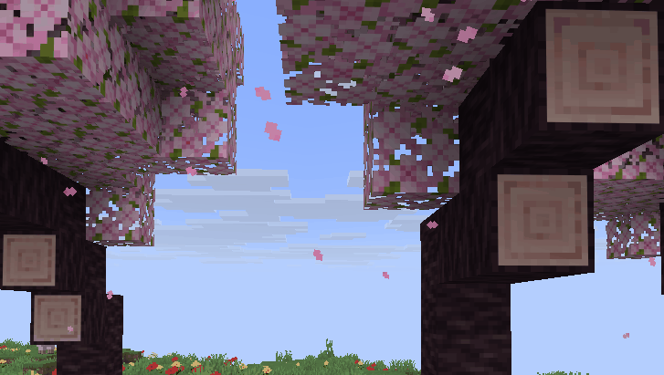
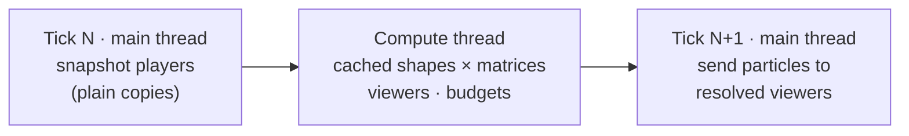
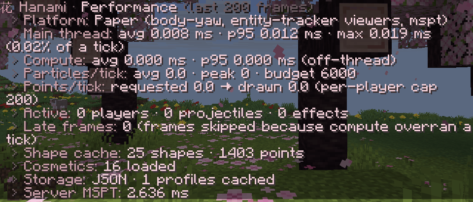

<p align="center">
  
</p>

<p align="center">
  <a href="https://github.com/jeary-dev/Hanami/actions/workflows/build.yml"></a>
  
  
  
  
  <a href="LICENSE"></a>
</p>

<p align="center"><i>Petals that drift where you walk. Wings drawn in light. A torii gate inked into the air.</i></p>

**Hanami** (花見, *"flower viewing"*) is a cosmetics plugin for Spigot and Paper with a quiet, Japanese-inspired look. Every effect is drawn from **parametric maths** (circles, helices, Lissajous orbits, bézier wings, even kanji turned into particles) and defined entirely in YAML, so server admins can design new cosmetics without touching code.

It's also built to be cheap. One scheduler drives every cosmetic on the server, the maths runs off the main thread, and per-player and global particle budgets keep output bounded however many players gather in one spot.

---

## ✿ Features

- **Five cosmetic types**, each a separate module behind one interface:
  - **Trails**: petals, ink wisps, lantern embers, koi ripples that spread across the water
  - **Auras**: an orbiting petal storm, a slowly turning ring of kanji (花 風 月), a firefly cloud
  - **Wings**: sakura, crane and fox-fire wings that flap on an animation curve and follow your *body* yaw, not your head
  - **Projectile trails**: helices wrapped around an arrow's flight path, ink brushstrokes
  - **Emotes and kill effects**: a petal whirlwind, a torii gate drawn stroke by stroke, an ink splash with an ensō circle
- **Parametric shapes**: circle, spiral, helix, Lissajous, sphere, line, polyline, bézier, glyph (text → particles), plus mirror, union, transform and radial combinators. Shapes are sampled once, evenly by arc length, cached, and rotated per tick with 3×3 matrices.
- **Everything is data**: particles (including colour transitions and palettes that cycle), shapes, animation curves, keyframes, emission modes, prices, permissions, icons and lore.
- **Safe `/hanami reload`**: every file is validated, and errors name the file, the path and the problem:
  ```
  cosmetics.yml → cosmetics.koi_ripple.shape.radius: expected a number between 0.01 and 32, got "big"
  ```
  If any file is broken, nothing changes. A single broken cosmetic is skipped and the rest still load.
- **A data-driven GUI**: paginated category menus drawn as character grids in `menus.yml`. They show whether each cosmetic is worn, unlocked, for sale or locked, and right-click previews any of them for 5 seconds, visible only to you.
- **Player settings**: hide other players' cosmetics, and choose a personal particle density (low / medium / high) for weaker PCs.
- **Storage**: one JSON file per player (default, zero setup), SQLite, or MySQL through HikariCP with versioned migrations. Saves are atomic, and everything is async and cached while the player is online.
- **Admin GUI** (`/hanami admin`): give, revoke, equip and remove cosmetics for online players, and a **cosmetic creator** to design new cosmetics with buttons, preview them on yourself, and save them straight into `cosmetics.yml`.
- **Unlocks**: by permission, by purchase with any Vault economy (with a confirmation menu), or by admin grant, which also works for offline players.
- **Integrations** (all optional): Vault, PlaceholderAPI, and Essentials / SuperVanish / PremiumVanish.
- **Public API** with cancellable events for other plugins.

## 🌸 The default cosmetics

| | Cosmetic | Type | Notes |
|---|---|---|---|
| 🌸 | **Sakura Drift** | Trail | Real cherry petals flutter down from shoulder height |
| 🖌 | **Sumi Wisps** | Trail | A two-strand ink helix swept upward |
| 🏮 | **Lantern Embers** | Trail | Rising sparks and embers cooling from amber to vermilion |
| 🐟 | **Koi Ripple** | Trail | Water only. Ripples keep expanding where you left them, while two koi chase each other around them |
| 🌬 | **Hanafubuki** | Aura | Petals on a slow Lissajous orbit that dips and rises |
| 花 | **Kanji Ring** | Aura | 花 · 風 · 月 drawn from real font outlines, turning slowly |
| ✨ | **Hotaru** | Aura | Fireflies that breathe light (uses `FIREFLY` on 1.21.5+, glowing dust before that) |
| 🪽 | **Sakura Wings** | Wings | Petal-shaped wings with the sakura notch, plus veins and shedding petals |
| 🕊 | **Tsuru** | Wings | Long crane wings with ink-dipped tips and a slow, deep beat |
| 🦊 | **Kitsunebi** | Wings | Three fox-fire tails with soul flames running along them |
| 🏹 | **Petal Arrow** | Projectile | A blossom helix wrapped around the flight path |
| 筆 | **Fude** | Projectile | Your arrow becomes a brush |
| 🌪 | **Petal Storm** | Emote | A three-strand whirlwind that grows into the sky |
| ⛩ | **Torii** | Emote | A shrine gate drawn stroke by stroke, then gilded |
| ◯ | **Ink Splash** | Emote | A burst of sumi ink and an unclosed ensō circle |

| Trails | Auras | Wings |
|---|---|---|
|  |  |  |

| Projectiles | Emotes | Menu |
|---|---|---|
|  |  |  |

## 📦 Installation

1. Download `Hanami-<version>.jar` from [Releases](https://github.com/jeary-dev/Hanami/releases) and drop it into `plugins/`.
2. Start the server. Hanami runs on **Spigot or Paper, 1.20.6 to 1.21.x, Java 21**.
3. Optional: install **Vault** plus an economy plugin for purchases, and **PlaceholderAPI** for placeholders.

On first start the server downloads Kotlin and the JDBC drivers through Bukkit's `libraries:` mechanism, which keeps the plugin jar small.

> **Kanji glyphs** need a font with CJK characters on the *server* host (Windows and macOS have one; on Linux install e.g. `fonts-noto-cjk`). Without one, glyph shapes use their configured `fallback:` shape and a warning explains why.

## ⌨ Commands

Aliases: `/sakura`, `/cosmetics`. Every command has tab completion, and `/hanami equip wings <TAB>` only suggests wings.

| Command | Description | Permission |
|---|---|---|
| `/hanami` | Open the cosmetics menu (prints help in the console) | `hanami.command.menu` |
| `/hanami equip <type> <id> [player]` | Wear a cosmetic (on another player bypasses unlocks) | `hanami.command.equip` (`.others`) |
| `/hanami unequip <type> [id]` | Take a cosmetic off | `hanami.command.equip` |
| `/hanami preview <id>` | Try any cosmetic for 5 seconds, visible only to you | `hanami.command.preview` |
| `/hanami emote` | Play your equipped emote (per-emote cooldown) | `hanami.command.emote` |
| `/hanami give <player> <id>` | Permanently unlock a cosmetic, even for offline players | `hanami.command.give` |
| `/hanami revoke <player> <id>` | Remove a granted cosmetic | `hanami.command.revoke` |
| `/hanami reload` | Validate and reload all four config files | `hanami.command.reload` |
| `/hanami debug` | Tick cost, compute time, particle counts, budgets | `hanami.command.debug` |
| `/hanami admin` | Admin menu: manage players' cosmetics, open the cosmetic creator | `hanami.command.admin` (creator: `hanami.command.create`) |
| `/hanami help` | Command overview | — |

## 🔑 Permissions

| Permission | Default | Grants |
|---|---|---|
| `hanami.player` | everyone | menu, equip, preview, emote |
| `hanami.admin` | op | everything below, plus every cosmetic |
| `hanami.cosmetic.<id>` | — | unlocks one cosmetic (configurable per cosmetic) |
| `hanami.cosmetic.*` | op | unlocks every cosmetic |
| `hanami.command.equip.others` | op | equip on other players |
| `hanami.command.give` / `.revoke` | op | grant / remove unlocks |
| `hanami.command.reload` / `.debug` | op | admin tools |
| `hanami.command.admin` / `.create` | op | admin menu / cosmetic creator |

A cosmetic is unlocked if it has `unlock.default: true`, the player has its permission, or it was bought or granted.

## 🏷 Placeholders

Requires PlaceholderAPI. `<type>` is `trail`, `aura`, `wings`, `projectile` or `emote`.

| Placeholder | Example |
|---|---|
| `%hanami_<type>%`, e.g. `%hanami_trail%` | `Sakura Drift` (or `None`) |
| `%hanami_<type>_id%` | `sakura_drift` |
| `%hanami_unlocked_count%` | `7` |
| `%hanami_unlocked_count_<type>%` | `2` |
| `%hanami_total_count%` | `15` |
| `%hanami_density%` | `medium` |
| `%hanami_show_others%` | `true` |

## 🎨 Making your own cosmetic

**In game:** run `/hanami admin` and open the **Cosmetic creator**. Pick a type, shape, colours and motion with buttons, preview it on yourself, then save. The cosmetic is appended to `cosmetics.yml` as normal YAML and reloaded immediately, so you can fine-tune it by hand afterwards. The creator makes single-layer cosmetics; for multi-layer designs, write the YAML directly:

Add an entry to `plugins/Hanami/cosmetics.yml` and run `/hanami reload`. This aura draws a slowly turning, pulsing lotus of eight bézier petals:

```yaml
cosmetics:
  lotus:
    type: aura
    name: '<gradient:#f7c6d9:#ffffff>Lotus</gradient>'
    lore:
      - '<#9c8a8f>Eight petals open beneath you.'
    icon: { material: PINK_TULIP, glow: true }
    unlock:
      permission: hanami.cosmetic.lotus   # optional, this is the default
      price: 5000                         # optional, requires Vault
    aura: { idle-only: true }

    # A petal outline on the floor, repeated 8 times around a circle.
    shape:
      kind: radial
      radius: 0.35
      count: 8
      shape:
        kind: transform
        rotate: [90, 0, 0]                # lay the upright petal flat, tip outward
        shape:
          kind: bezier
          points: 18
          segments:
            - [[0, 0], [-0.25, 0.25], [-0.15, 0.6], [0, 0.7]]
            - [[0, 0.7], [0.15, 0.6], [0.25, 0.25], [0, 0]]
    offset: [0, 0.05, 0]

    layers:
      - particle: { kind: dust_transition, colors: ['#f7c6d9', '#ffffff'], size: 0.6 }
        palette: { colors: ['#f7c6d9', '#ffe3ef', '#fff7d6'], cycle-ticks: 100, curve: sine }
        animation:
          rotate: { yaw: 10 }              # degrees per second
          bob: { amplitude: 0.05, period-ticks: 60, curve: sine }
          scale: 1.2
        emit: { interval-ticks: 3 }
      # a second layer reusing the same shape: light running round the petals
      - particle: { kind: simple, particle: END_ROD }
        emit:
          mode: sweep
          sweep: { heads: 2, cycles-per-second: 0.2, tail: 0 }
          interval-ticks: 4
```

### Reference

**Common keys:** `type`, `name`, `lore`, `icon {material, custom-model-data, glow}`, `category-order`, `unlock {permission, price, default}`, then `particle`, `shape`, `offset`, `palette`, `animation`, `emit`, either at the top level or per entry in `layers:`. Layers inherit any top-level key they don't set themselves.

<details>
<summary><b>Shapes</b> (all parametric; nest freely)</summary>

| `kind` | Keys |
|---|---|
| `point` | — |
| `line` | `from`, `to`, `points` |
| `polyline` | `vertices` (`[x,y,z]` or `[u,v]` on `plane`), `points` |
| `circle` | `radius`, `points`, `plane` (`xz`/`xy`/`yz`), `arc` (degrees) |
| `spiral` | `turns`, `radius-start`, `radius-end`, `height`, `points`, `plane` |
| `helix` | `radius`, `height`, `turns`, `strands`, `points` |
| `lissajous` | `a`, `b`, `c`, `delta`, `amplitude [x,y,z]`, `points` |
| `sphere` | `radius`, `points`, `shell` (Fibonacci lattice) |
| `bezier` | `segments: [[p0, c1, c2, p1], …]`, `points`, `plane` (default `xy`) |
| `glyph` | `text`, `font`, `size`, `points`, `fallback` |
| `mirror` | `axis`, `shape` |
| `union` | `shapes: [...]` |
| `transform` | `shape`, `translate`, `rotate [pitch, yaw, roll]`, `scale` |
| `radial` | `radius`, `count`, `shape` or `shapes` (alternating) |

Curves are resampled **by arc length**, so particles are evenly spaced along a bézier or a glyph outline.
</details>

<details>
<summary><b>Particles</b></summary>

| `kind` | Keys |
|---|---|
| `simple` | `particle` (any data-less particle, e.g. `CHERRY_LEAVES`, `END_ROD`) |
| `dust` | `color`, `size` |
| `dust_transition` | `colors: [from, to]`, `size` |
| `color` | `particle`, `color` (e.g. `ENTITY_EFFECT`) |
| `block` | `particle`, `block` |
| `item` | `particle`, `item` |

Any particle can name a `fallback:` particle for server versions that don't have it.
</details>

<details>
<summary><b>Animation & emission</b></summary>

- `animation.rotate {yaw, pitch, roll}`: continuous rotation in degrees per second
- `animation.bob {amplitude, period-ticks, curve}`: vertical oscillation
- `animation.flap {angle, period-ticks, curve}`: wing beat (wings only)
- `animation.keyframes [{at, scale, curve}]`: scale over an effect's lifetime
- `animation.follow-body-yaw`: orient with the player's body
- `emit.mode`:
  - `all`: every point
  - `sweep {heads, cycles-per-second, tail}`: moving markers
  - `random {count}`: a random sample each frame
  - `progressive`: draws the shape over the effect's lifetime
- `emit.interval-ticks`, `count`, `spread [x,y,z]`, `speed`, `direction [x,y,z]`, `max-points-per-frame`
- **Curves**: `linear`, `sine`, `ease_in`, `ease_out`, `ease_in_out`, `pulse`, `bounce`. The same curve drives keyframes and periodic motion.
- **Type blocks**:
  - `trail {min-speed, mode: behind|feet|water-surface, linger-ticks, drop-interval-ticks}`
  - `aura {idle-only}`
  - `wings {scale, tilt, height, back, sneak-tuck}`
  - `projectile {applies-to, max-lifetime-ticks}`
  - `emote {duration-ticks, trigger: [kill, command], cooldown-seconds}`
</details>

Wings describe only the **right** wing on the XY plane (+x pointing away from the spine). Hanami mirrors it and flaps both sides.

## ⚡ Performance



- **One task for the whole server.** No per-player or per-cosmetic schedulers. Emission intervals are staggered per player, so many 4-tick auras spread their work across four ticks instead of spiking one.
- **The maths runs off the main thread.** The main thread only copies positions into immutable snapshots and sends packets. If a compute pass ever overruns a tick, that frame is skipped rather than queued.
- **Viewer-aware.** Particles go only to players in range who haven't hidden cosmetics. On Paper, viewers come from the entity tracker; on Spigot, `canSee` respects vanish plugins. Each viewer's density setting thins what *they* receive.
- **Budgets.** A per-player cap and a global cap on points × viewers. When over budget, shapes get sparser instead of disappearing.
- **Skipped entirely** for invisible, spectating, vanished, dead, blacklisted-world and (optionally) in-combat players.
- **`/hanami debug`** shows average, p95 and max main-thread time per tick (and its share of the 50 ms tick budget), compute time, particles per tick, points before and after budgets, late frames, shape cache size and, on Paper, server MSPT.

<p align="center"></p>

## 🧩 Developer API

```kotlin
val hanami = HanamiApi.get() ?: return
hanami.cosmetic(CosmeticId.of("sakura_wings"))?.let { hanami.equip(player, it) }

@EventHandler
fun onEquip(event: CosmeticEquipEvent) {
    // no wings in the spawn world
    if (event.cosmetic.type == CosmeticType.WINGS && event.player.world.name == "spawn") {
        event.isCancelled = true
    }
}
```

Events (all cancellable, all on the main thread): `CosmeticEquipEvent`, `CosmeticUnequipEvent`, `CosmeticUnlockEvent` (purchase / admin / API), `CosmeticPlayEvent` (emote, kill, preview).

## 🔨 Building

```bash
./mvnw clean package      # Windows: mvnw.cmd clean package
```

Requires JDK 21; the Maven Wrapper downloads Maven itself. The output is a single drop-in jar: `target/Hanami-<version>.jar`. Maven also leaves `original-Hanami-<version>.jar`, the unshaded build, which isn't for servers. The build runs the test suite and treats compiler warnings as errors.

CI builds every push, and publishing a GitHub release attaches the jar to it.

<details>
<summary><b>Project layout</b></summary>

```
dev.jeary.hanami
├── api/          public surface: HanamiApi, CosmeticView, events
├── core/         composition root, tick pipeline, rendering, profiles, unlocks, visibility, Paper/Spigot compat
├── math/         Vec3, Mat3, PointCloud, Easing, parametric shapes (no Bukkit imports)
├── cosmetics/    one module per type: trail, aura, wings, projectile, emote
├── config/       typed, path-aware YAML parsing and validation
├── storage/      repository interface, SQLite/MySQL (HikariCP), migrations
├── menu/         reusable menu framework + the Hanami menus
├── command/      Incendo Cloud commands and argument parsers
└── hook/         Vault, PlaceholderAPI, vanish, bStats
```

Shaded and relocated under `dev.jeary.hanami.libs`: Adventure + MiniMessage, Incendo Cloud, HikariCP, bStats. Kotlin, sqlite-jdbc and the MySQL driver are loaded through `plugin.yml` `libraries:`; relocating sqlite-jdbc would break its native library.
</details>

## 📜 License

Hanami is released under the [MIT License](LICENSE).

---

<p align="center"><sub>made with 🌸 by <a href="https://github.com/jeary-dev">jeary-dev</a></sub></p>
